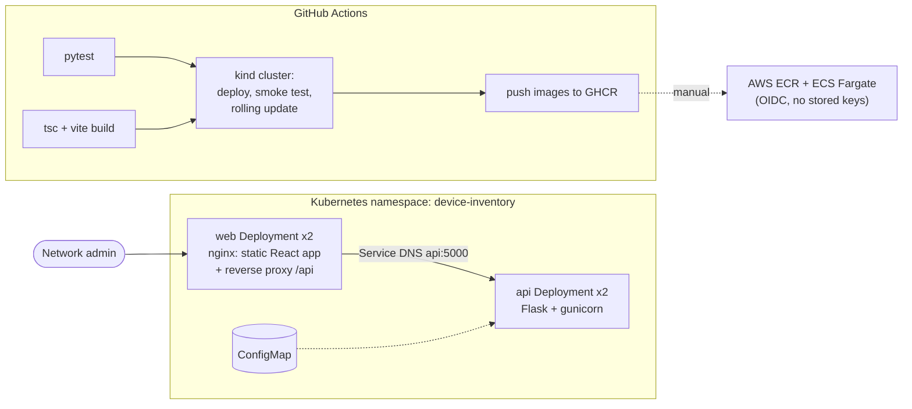

# Device Inventory Platform

[](https://github.com/roberto-t-plascencia/device-inventory-platform/actions/workflows/ci.yml)

A small full-stack app for onboarding and configuring network devices. It was built to
show the whole delivery path: a **React + TypeScript** admin UI and a **Python** REST API,
packaged as **Docker** images, deployed to **Kubernetes**, and tested end to end in
**GitHub Actions**, with an optional deployment to **AWS ECS Fargate**.



## What's in the repo

| Path | What it is |
|---|---|
| `api/` | Flask REST API: list/filter, get, create (validation, 409 on duplicate MAC), PATCH, DELETE, `/api/health`, `/api/version`. Served by gunicorn as a non-root user. 14 pytest tests. |
| `web/` | React 18 + TypeScript (Vite): device list with search/filter, onboarding form with client-side validation, a status monitor that polls with backoff. Multi-stage Dockerfile: Node build stage → `nginx-unprivileged` runtime (~no Node in the final image). |
| `k8s/base` | Namespace, Deployments with readiness/liveness probes, resource requests/limits, zero-downtime rolling updates (`maxUnavailable: 0`), hardened security context, Services, ConfigMap, PodDisruptionBudget. |
| `k8s/overlays/kind` | Kustomize overlay for local/CI clusters (side-loaded `:ci` images). |
| `.github/workflows/ci.yml` | Tests → build images → **create a kind cluster** → deploy → smoke test through nginx → rolling update → publish images to GHCR on `main`. Prints pod logs and events if anything fails. |
| `.github/workflows/deploy-ecs.yml` | Manual deploy of the API to ECS Fargate through ECR, using GitHub OIDC. Off until configured; see [docs/aws-setup.md](docs/aws-setup.md). |
| `docker-compose.yml` | Run the full stack locally. |

## Run it locally

With Docker:

```bash
docker compose up --build
# UI:  http://localhost:8080      API: http://localhost:5000/api/devices
```

Without Docker:

```bash
# API (terminal 1)
cd api && python -m venv .venv && source .venv/bin/activate   # Windows Git Bash: source .venv/Scripts/activate
pip install -r requirements-dev.txt && pytest -q && python app.py

# Web (terminal 2) — Vite proxies /api to localhost:5000
cd web && npm install && npm run dev                          # http://localhost:5173
```

On a local Kubernetes cluster (kind):

```bash
kind create cluster --name demo
docker build -t device-inventory-api:ci api && docker build -t device-inventory-web:ci web
kind load docker-image device-inventory-api:ci device-inventory-web:ci --name demo
kubectl apply -k k8s/overlays/kind
kubectl -n device-inventory rollout status deploy/api
kubectl -n device-inventory port-forward svc/web 8080:80      # http://localhost:8080
```

The header shows the API version and the pod hostname, so refreshing shows requests
being load-balanced across replicas.

## API

| Method | Path | Notes |
|---|---|---|
| GET | `/api/devices?status=&q=` | Filter by status; search name, IP, MAC |
| GET | `/api/devices/{id}` | 404 if missing |
| POST | `/api/devices` | `{name, mac, ip, vlan}`; 400 with per-field errors; 409 on duplicate MAC |
| PATCH | `/api/devices/{id}` | `name`, `ip`, `vlan` only |
| DELETE | `/api/devices/{id}` | 204 |
| GET | `/api/health`, `/api/version` | Probes / build info |

## Design notes and next steps

- **Storage is in memory** to keep the demo self-contained, so each API replica has its own
  data. Next step: PostgreSQL (RDS) with a unique constraint on MAC, which is also the right
  place to enforce duplicates under concurrent requests.
- **Config to devices:** in a real system a PATCH would record the *desired* config, and an
  agent on the device (or a job queue) would apply it and report *actual* state back, with
  idempotent retries and rollback if the device does not come back healthy.
- **Service-to-service:** REST at the browser edge; gRPC with shared proto definitions is a
  good fit between internal services.
- **Constrained devices:** the web image is static files behind nginx; the React bundle is
  ~150 KB (~48 KB gzipped) with no UI framework dependencies.
- **Production hardening:** Ingress + TLS (or an AWS ALB), HPA on CPU/RPS, secrets from AWS
  Secrets Manager via External Secrets, image scanning in CI, and canary rollouts.
